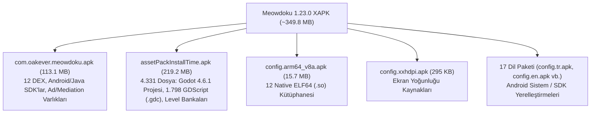

# Meowdoku (`com.oakever.meowdoku` v1.23.0) — REA Statik Analiz Raporu

Bu rapor, [meowrae](file:///home/iso/Projects/meowrae) dizininde bulunan **Meowdoku: Brain Puzzle Games** (`1.23.0`, Build `1669`) XAPK/Split-APK paketinin `rea@6.8.0` (`inspect-artifact`, `inspect-apk-signature`, `decode-android-resources`, `extract-artifact`, `inspect-elf-notes`, `inspect-native-exports`, `inspect-byte-entropy`) araçlarıyla yapılan kapsamlı incelemesini içerir.

---

## 1. Paket Kimliği ve İmza Yapısı

| Özellik | Değer |
| :--- | :--- |
| **Uygulama Adı** | Meowdoku (`com.oakever.meowdoku`) |
| **Geliştirici / Altyapı** | Oakever Games / **Learnings (Lexin / 乐信圣文)** (`com.learnings.*`, `dailyinnovation.biz`) |
| **Sürüm** | `1.23.0` (`versionCode: 1669`) |
| **SDK Seviyeleri** | `minSdkVersion: 24` (Android 7.0) / `targetSdkVersion: 36` (`compileSdkVersion: 36`, Android 16) |
| **Oyun Motoru** | **Godot Engine 4.6.1** (`Mobile` / `gl_compatibility`, Jolt Physics 3D, GDScript Bytecode v101 `GDSCe`) |
| **Toplam Boyut** | ~349.5 MB (21 Split APK + [manifest.json](file:///home/iso/Projects/meowrae/manifest.json)) |
| **APK İmza Şeması** | APK Signature Scheme **v2** ve **v3** aktif (`v1` kapalı), Google Play Source Stamp mevcut |
| **İmza Sertifikası (SHA-256)** | `3b6be38bc51a3459c0e37ea451f43769eca08ba7f8bf3f330ffe1c942230c045` |

### Split APK Dağılımı

---

## 2. Native Kütüphaneler ([config.arm64_v8a.apk](file:///home/iso/Projects/meowrae/config.arm64_v8a.apk))

`rea inspect-elf-notes`, `rea inspect-native-exports` ve `rea inspect-byte-entropy` ile incelenen 12 adet `arm64-v8a` ELF64 kütüphanesi:

| Kütüphane | Boyut | Export Sayısı | İşlevi ve Bulgular |
| :--- | :--- | :--- | :--- |
| `libgodot_android.so` | 41.56 MB | 495 (66 JNI) | Ana **Godot 4.6.1** Android motoru (`GNU Build-ID: b8b284663891819d`, ortalama entropi `6.6854`). İçerisinde FreeType, WebP, Zstandard (`ZSTD_*`), Jolt Physics ve Spine 2D iskelet animasyon desteği statik olarak derlenmiştir. |
| `libgodot_vpx.android.template_release.arm64.so` | 865 KB | 1 (`godot_vpx_library_init`) | `res://addons/godot_vpx/godot_vpx.gdextension` üzerinden yüklenen **GDExtension** eklentisi. |
| `libvpxplayer.so` | 601 KB | 15+ (`vpxplayer_*`) | Alfa kanallı WebM/VP8/VP9 video oynatıcı (`yuva_to_rgba.gdshader` ile şeffaf video efektleri için). |
| `libapplovin-native-crash-reporter.so` | 868 KB | 300+ | AppLovin MAX native çökme yakalayıcısı. |
| `libapminsighta.so` & `libapminsightb.so` | 102 KB / 124 KB | 1 / 40+ | ByteDance APMInsight çökme/performans izleme ve LZMA/XZ sıkıştırma modülü. |
| `libtt_ugen_layout.so` | 441 KB | 200+ | ByteDance/Pangle reklam şablonları için Facebook **Yoga** (`facebook::yoga::Node`, `YGNode*`) tabanlı dinamik arayüz motoru. |
| `libpglarmor.so` & `libnms.so` | 69 KB / 297 KB | 1 / 1 | ByteDance Pangle (`PglCryptUtils.bc`) veri şifreleme ve reklam sahtekarlığı önleme (anti-fraud) kütüphaneleri. |
| `libbuffer_pgl.so` & `libfile_lock_pgl.so` | 9 KB / 6 KB | 12 / 6 | ByteDance GeckoX (`com.bykv.vk.openvk.preload.geckox`) reklam önbellekleme (`mmap` ve dosya kilitleme) bileşenleri. |
| `libc++_shared.so` | 1.25 MB | 1000+ | Android NDK paylaşımlı C++ standart kütüphanesi. |

---

## 3. Oyun Motoru ve GDScript Mimarisi ([assetPackInstallTime.apk](file:///home/iso/Projects/meowrae/assetPackInstallTime.apk))

Oyunun tüm asıl mantığı ve görsel/işitsel varlıkları `install-time` asset pack olan [assetPackInstallTime.apk](file:///home/iso/Projects/meowrae/assetPackInstallTime.apk) içerisindeki `assets/` klasöründe yer almaktadır:

- **Proje Yapılandırması (`assets/project.binary` & `assets/_cl_`):**
  - Başlangıç sahnesi: `res://launcher.tscn` (`uid://b7eqvkjrlbffh`)
  - Komut satırı argümanları (`_cl_`): `--xr_mode_regular --xr-mode off --fullscreen --edge_to_edge --background_color #000000`
  - **Editör Eklentileri İzleri:** `project.binary` içerisinde geliştirme aşamasında kullanılan 20 eklenti kayıtlıdır; bunların arasında **`res://addons/godot_mcp/plugin.cfg`** (geliştiricilerin de Godot MCP kullandığını gösteriyor), `art_to_prefab_tool`, `level_bank_encryptor`, `code_coverage`, `ui_code_generator`, `unikit` (`com.learnings.godot.unikit v2.6.1-v2`) ve `lxlogin` yer alır.
- **Derlenmiş GDScript Bytecode (`.gdc`):**
  - Toplam **1.798 adet `.gdc` dosyası** ve `global_script_class_cache.cfg` içinde tanımlı **801 global GDScript sınıfı** mevcuttur.
  - `.gdc` dosyaları Godot 4.6 formatında (`GDSCe`, bytecode sürümü `101`, `Zstandard` sıkıştırmalı ve tanımlayıcı tablosu `0xB6` XOR maskeli) saklanmaktadır.

### 28 Autoload (Singleton) Servisi
`project.binary` içerisinden çıkarılan global servisler:
- **Çekirdek & Durum:** `GameState`, `EventBus`, `UIManager`, `ScreenManager`, `SoundManager`, `LanguageManager` (76 `.translation` dosyası), `PowerSaver`, `SpineIdleGuard`, `ClockTicker`
- **Oynanış & Etkinlikler:** `StreakManager` (günlük seri), `AwardManager`, `RankActivityManager` (lig/sıralama), `RobotService` (sıralama tablosu için simüle edilen bot oyuncular), `LevelRecManager` (algoritmik seviye önerisi), `PeekabooManager` (mini etkinlik), `RedDotCenter`
- **Hesap, Bulut & SDK Köprüleri:** `UniKit`, `UniKitManager`, `LXAuth`, `AuthManager`, `AccountManager`, `DataSyncManager`, `PurchaseManager`, `HelpshiftManager`, `NativeUtilManager`
- **Hata Ayıklama & Hile (Debug/Cheat):** `CheatBus`, `DcProbe`

### Modül Dağılımı (`assets/scripts/module/`)
| Modül | Script Sayısı | Açıklama |
| :--- | :--- | :--- |
| `abtest` | 193 | Çok katmanlı A/B testi stratejileri, arayüz, font (`Baloo2`, `AliMama`, `GeomEN`, `SourceHan`) ve zorluk deneyleri |
| `gameplay` | 153 | Izgara/hücre görünümü (`cell_view`), dokunma/kaydırma bölgeleri, ipucu (`hint`/`locate`) ve hata vurgulama |
| `game` | 84 | Seviye işlemleri (`level_ops`), yanlış bölge takibi (`wrong_zone_tracker`), kazanma mesajları |
| `rank_activity` | 59 | Küme/lig sistemi, ödül hesaplama ve bot entegrasyonu (`rank_robot_wrapper`) |
| `ui` | 53 | Pencere/katman yönetimi (`UIFrameWindow`), bildirim noktaları (`red_dot`) |
| `account` & `data_sync` | 22 + 10 | Kullanıcı girişi (`LoginBridge`), bulut kayıt senkronizasyonu ve çakışma çözümü |
| `cheat` & `debug` | 22 + 12 | Geliştirici hile paneli (`cheat_panel.gdc`, `cheat_commands.gdc`), FPS sayacı, uzaktan konsol (`remote_console_access.gdc`), sahte reklam/banner sayfaları |
| `daily` & `daily_streak` | 17 + 18 | Günlük mücadeleler, kostüm açma ve seri kurtarma (`streak_revive`) akışları |
| `robot` | 14 | `user://robots.cfg` üzerinde çalışan, gerçekçi puan artış eğrileri (`RobotScoreGen`, `RobotStalk`, `RobotBoost`) üreten çevrimdışı/hibrit bot simülasyonu |

---

## 4. Seviye Bankaları, Kayıt Sistemi ve Ağ Mimarisi

1. **Seviye Formatı (`MDBK` & `assets.sparsepck`):**
   - `assets/resources/levels/` ve `assets.sparsepck` (`GDPC` v3 paketi) içerisinde 4x4'ten 12x12'ye kadar (`bankData4x4.bin` .. `bankData12x12.bin`, `bankDataSuperHardR4.bin`, `bankDataColorChallenge.bin`, `bankDataLKStyle*.bin`) seviye dosyaları yer alır.
   - `bank_binary_format.gdc` ve `bank_level_codec.gdc` incelemesine göre `.bin` dosyaları `MDBK` başlığına sahiptir; `solution`, `regionMap`, `stepHist` ve `stepOrderZ` vektörlerini Zstandard (`COMPRESSION_ZSTD`) ile sıkıştırılmış Godot `Variant` formatında tutar.
2. **Yerel Kayıt Yapısı (`SaveStore` & `GameState`):**
   - Oyuncu verileri `user://save_store/` altında çift slotlu atomik yazma (`save_a.cfg`, `save_b.cfg`, `flag.txt` ve `endgame.cfg`) ile şifreli `ConfigFile` (`load_encrypted_pass`) olarak saklanır.
3. **Sunucu (Backend) Uç Noktaları (`api_config.gdc` & `http_client.gdc`):**
   - **Ana API:** `https://meowdoku-api.dailyinnovation.biz` (Test: `meowdoku-api-dev.dailyinnovation.biz`)
     - `/sync/v1/gamedata` & `/sync/v1/gamedata/meta` (Bulut kayıt senkronizasyonu)
     - `/account/v1/info` (Hesap bilgileri)
   - **Seviye Öneri (Recommendation) API:** `https://meowdoku-rec-api.dailyinnovation.biz`
     - `/meowdoku/v1/dispatch/rec/question/next` (Oyuncunun geçmiş istatistiklerine göre dinamik seviye ataması)
   - **Müşteri Desteği:** `arsenal-support.helpshift.com` (Helpshift SDK)
4. **Uygulama İçi Satın Alma (IAP) Tanımları (`purchase_define.gdc`):**
   - Reklamsız abonelik paketleri: `com.oakever.meowdoku.noad_1week`, `noad_1month`, `noad_1year` (ve `_2` indirimli baz varyantları; `$3.99` – `$69.99` aralığında).

---

## 5. Android / DEX Katmanı ve Reklam Ağı Ekosistemi ([com.oakever.meowdoku.apk](file:///home/iso/Projects/meowrae/com.oakever.meowdoku.apk))

Ana APK içerisinde **12 adet DEX dosyası (`classes.dex` .. `classes12.dex`)** yer alır. Java/Kotlin katmanı temel olarak Godot başlatıcısı (`com.godot.game.GodotApp`) ve **Learnings UniKit** reklam/analitik köprüsünden oluşur:

- **Özel Godot Android Eklentileri (`org.godotengine.godot.plugin.GodotPlugin`):**
  - `com.oakever.meowdoku.nativeutil.NativeUtilPlugin` (Ağ durumu, sürüm bilgisi, Firebase Crashlytics köprüsü)
  - `com.godot.game.SplashPlugin` (Açılış ekranı geçiş kontrolü)
  - `com.vita.plugins.vibrate.VibratePlugin` (Titreşim efektleri)
  - `com.vita.plugins.inappreview.InAppReviewPlugin` (Google Play uygulama içi değerlendirme)
  - `com.learnings.*` (`UniKitPlugin`, `AbCenter`, `UserTag`, `Luid`, `GRT`, `HelpshiftPlugin`, `LoginBridge`)
- **Gömülü Reklam ve Analitik SDK'ları:**
  - AppLovin MAX, Google AdMob / Ad Manager, ByteDance Pangle (`com.bytedance.sdk`), Mintegral (`com.mbridge.msdk`), Unity Ads (`com.unity3d.ads`), Moloco (`com.moloco.sdk`), BidMachine (`io.bidmachine`), Bigo Ads (`sg.bigo.ads`), InMobi, Fyber / Digital Turbine (`com.fyber.inneractive`), Chartboost, Vungle (Liftoff), PubMatic OpenWrap, Verve / HyBid (`net.pubnative.lite`), Yandex DivKit & AppMetrica, MyTarget, Maticoo (`com.zmaticoo.sdk`), AppsFlyer, Firebase Analytics/Messaging ve Facebook SDK.
