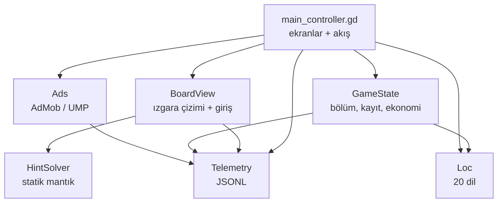

# Proje bağlamı — Bundoku

Bu belge, depoya ilk kez bakan bir geliştirici veya yapay zekâ asistanının 10 dakikada doğru modeli kurması için yazılmıştır. Ayrıntılı plan: [../plan/README.md](../plan/README.md). Sağlık ve riskler: [PROJECT_HEALTH.md](PROJECT_HEALTH.md).

## Oyun nedir

Bundoku, **Star Battle / Queens** ailesinden bir mantık bulmacasıdır. 4×4–9×9 ızgarada oyuncu, her satır, sütun ve renkli bölgeye tam olarak bir tavşan yerleştirir. Tavşanlar dikey, yatay veya çapraz komşu olamaz. Tema: pastel fırın/çayır ve tavşan; oturumlar kısa, kayıp durumu yok.

| Alan | Değer | Kaynak |
|---|---|---|
| Paket | `com.bundoku.puzzle` | `export_presets.cfg` |
| Android sürüm | `1.0.4`, code `5` | `export_presets.cfg` |
| Proje sürümü | `1.0.0` | `project.godot` (uyumsuz) |
| Motor | Godot 4.7 bildirimi, 4.7.2 stable derleme | `project.godot`, `android/.build_version` |
| Renderer | GL Compatibility | `project.godot` |
| Görünüm | 540×960, dikey, `canvas_items` + `expand` | `project.godot` |
| Bölüm | 120 adet, 4×4–9×9, 30'ar easy/medium/hard/expert | `assets/levels/levels_database.json` |
| Dil | 20 dil sözlüğü; eksik anahtar için EN → TR fallback | `scripts/core/loc.gd` |
| Autoload | `SoundManager`, `GameState`, `Telemetry`, `Ads` | `project.godot` |

## Mimari özet

Tek sahne vardır: `scenes/main.tscn` → kök `Control` → `scripts/ui/main_controller.gd`. Arayüz sahne dosyasında değil, kodda kurulur (`_build_home_screen`, `_build_game_screen`, `_show_*_modal`). Oyun tahtası ayrı bir `Control` olan `BoardView` tarafından çizilir ve `_gui_input` ile dokunmayı işler.

### Çekirdek servisler

| Autoload | Dosya | Sorumluluk | Dışa açtığı başlıca API |
|---|---|---|---|
| `GameState` | `scripts/core/game_state.gd` | Bölüm listesi, ilerleme, ipucu/havuç, kupa, lig rakipleri, reklam sayacı, ayarlar | `get_level`, `complete_level`, `use_hint`, `use_carrot`, `save_game`, `get_leaderboard` |
| `Loc` (statik sınıf) | `scripts/core/loc.gd` | 20 dilli sözlük ve fallback | `Loc.t(key)`, `Loc.quotes()`, `Loc.LANGUAGES` |
| `SoundManager` | `scripts/core/sound_manager.gd` | Ses/müzik, dosya yoksa prosedürel ton | `play(id)`, `set_music_enabled` |
| `Telemetry` | `scripts/core/telemetry.gd` | Rıza kapısı, JSONL yazımı, otomatik `ui_tap` | `track`, `set_screen`, `set_level_context`, `set_consent` |
| `Ads` | `scripts/ads/ad_manager.gd` | UMP, interstitial/rewarded/banner, simüle fallback | `start`, `show_interstitial`, `show_rewarded`, `banner_height_px` |

`BoardView`, `HintSolver` sahne düğümü değildir; `class_name` ile tanımlanır. `HintSolver` tamamen statiktir ve yan etkisizdir.

### Oynanış veri akışı

1. `main_controller.start_level(idx, source)` bölümü `GameState.get_level` ile alır, `level_start` olayını yazar ve `BoardView.setup_level` çağırır.
2. `BoardView`, `regionMap`, `solution` ve `prefillPositions` alanlarını kopyalar; hücre durumları `0=boş, 1=X, 2=tavşan` olarak tutulur.
3. Her yerleştirme/kaldırma `_recheck_conflicts_and_win` çalıştırır; çakışma yoksa ve tavşan sayısı `grid_size` ise `board_solved` yayılır.
4. `main_controller._on_board_solved` → `GameState.complete_level` yıldız, kupa, bonus ve reklam kararını üretir; ardından kazanma veya reklam modalı açılır.

### Kalıcılık

Tek dosya: `user://bundoku_save.cfg`, düz `ConfigFile` (şifresiz). Bölümler:

| Bölüm | Alanlar |
|---|---|
| `progress` | `current_level_index`, `unlocked_level_index`, `completed_levels`, `hints_count`, `carrots_count`, `streak_days`, `player_trophies`, `league_rivals` |
| `ads` | `levels_since_last_ad`, `total_ads_watched`, `no_ads_purchased` |
| `settings` | `auto_cross_enabled`, `pattern_mode_enabled`, `bunny_first_tap_mode`, `sound_enabled`, `music_enabled`, `language` |

`GameState.save_game()` her ödül/harcama sonrası yazar; `load_save()` eksik alanlar için varsayılan kullanır. Telemetri kimliği ve rıza durumu ayrı dosyadadır: `user://telemetry/state.cfg`.

### Yerelleştirme

- `Loc.LANGUAGES` 20 dili listeler: tr, en, es, de, fr, pt, it, ru, ar, zh, ja, ko, hi, bn, ur, id, vi, mr, te, sw.
- `Loc.t(key)`: aktif dilde yoksa `en`, o da yoksa `tr`, son çare anahtarın kendisi.
- İlk açılışta `OS.get_locale_language()` eşleşmesi; desteklenmeyen cihaz dili TR olur (`GameState._init_default_language`).
- Dil değişimi tüm UI'yi yeniden kurar (`_rebuild_all_ui_for_language`) ve `language_changed` olayı yazar.
- RTL dilleri (ar, ur) metin olarak vardır; yerleşim aynalanmaz (**Açık**).

### Reklam ve analitik

- Reklam: AdMob (Poing Studios eklentisi), UMP onayı, Meta mediation `admob/mediation/meta=true`. Birim kimlikleri `assets/ads/ads_config.json` içinde Google test kimlikleridir.
- Masaüstü, editör, fill yokluğu veya eklenti yokluğunda 3 saniyelik simüle modal devreye girer (`_show_simulated_ad_modal`).
- Banner yüksekliği `banner_loaded(height_px)` ile bildirilir ve alt boşluk rezervine dönüşür; Pixel 9'da 84 px ölçüldü.
- Analitik: yerel JSONL, `user://telemetry/events-YYYYMMDD.jsonl`, 2 MB rotasyon, 7 arşiv. Sunucuya yükleme yoktur.
- Rıza: EEA/UK/CH dışında `granted`, içinde `held` (en fazla 256 satır bellekte), `denied` satırları atar. Olay sözlüğü: [../analytics/EVENTS.md](../analytics/EVENTS.md).

## Kaynak haritası

| Yol | Ne var |
|---|---|
| `scripts/core/game_state.gd` | Bölüm yükleme, ilerleme, ekonomi, lig, kayıt |
| `scripts/core/loc.gd` | 20 dil sözlüğü, fallback |
| `scripts/core/sound_manager.gd` | Ses kanalları, prosedürel fallback |
| `scripts/core/telemetry.gd` | Olay hattı, rıza, rotasyon, `ui_tap` bağlama |
| `scripts/gameplay/board_view.gd` | Izgara çizimi, tek/çift dokunma, sürükleme, taslak, geri al, ipucu uygulama |
| `scripts/gameplay/hint_solver.gd` | 9 adımlı ipucu hattı |
| `scripts/ui/main_controller.gd` | Ev, oyun, sonuç, can bitti, lig, dil, reklam modalları |
| `scripts/ads/ad_manager.gd` | UMP, ön yükleme, banner, ödül sinyali, ILARE |
| `assets/levels/levels_database.json` | 120 bölüm |
| `assets/analytics/bigquery_schema.json` | Olay satırı şeması |
| `tools/bq_load.py` | JSONL → BigQuery yükleme |
| `docs/` | Plan, analitik, yayın, gizlilik |
| `REA/` | Referans oyun statik analizi |

## Yapay zekâ için çalışma kuralları

1. **Mevcut / Planlanan / Açık** ayrımını koru. `no_ads_purchased`, IAP, SSV, sunucu analitiği, RTL aynalama ve iOS **yoktur**.
2. Sayı uydurma: kullanıcı, gelir, eCPM, D1/D7, mağaza durumu veya tarih yazma. Yalnızca depodaki sabitleri ve doğrulanmış ölçümleri kullan.
3. Bir davranışı değiştirmeden önce ilgili `docs/plan/` belgesini ve `docs/analytics/EVENTS.md` sözleşmesini oku; olay adları ve parametreleri sözleşmedir.
4. UI kodda kurulur; yeni ekran eklerken `_build_*` ve `_show_*` desenini izle, `ui_tap` için `set_meta("telemetry_id", ...)` ekle.
5. Seviye verisini elle düzenleme; çözüm, bölge ve komşuluk doğrulaması olmadan yeni bölüm ekleme.
6. Parola, keystore parolası ve gerçek reklam kimliği dokümana yazma. `export_presets.cfg` içindeki parolaları kopyalama.
7. Belgeler Türkçedir, emoji kullanılmaz; tablolar düz metne tercih edilir.
