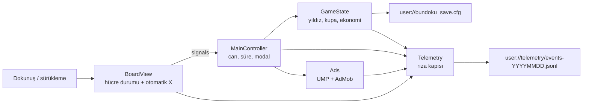

# 08 — Teknik mimari

> **Karar:** Bundoku tek sahneli, sunucusuz bir Godot 4.7.2 uygulamasıdır. Oyun durumu cihazda düz bir
> `ConfigFile` içinde tutulur; analitik cihazda JSONL olarak birikir ve hiçbir yere yüklenmez; reklamlar
> AdMob/UMP üzerinden çalışır, SDK yoksa simüle edilmiş modale düşer. Bu belge mevcut uygulamayı tarif eder,
> planlanan parçaları ayrıca işaretler.

Etiketler: **Mevcut** = kodda var, **Planlanan** = karar verildi/roadmap, **Açık** = eksik veya risk.
Kaynak: `project.godot`, `scripts/`, `android/build/config.gradle`, `build/android/Bundoku-debug.apk`.

## 1. Çalışma zamanı

| Öğe | Değer | Kaynak |
|---|---|---|
| Motor | Godot 4.7.2 stable, GL Compatibility | `android/.build_version`, `project.godot` |
| Proje özellikleri | Çalışma ağacında `"4.7"` (commit'li değer `"4.4"`) | `project.godot` |
| Çözünürlük | 540×960, `canvas_items`, `expand`, dikey | `project.godot` |
| Paket | `com.bundoku.puzzle`, `versionName 1.0.4`, `versionCode 5` | `export_presets.cfg` |
| Proje sürümü | `config/version="1.0.0"` (uyumsuz) | `project.godot` |
| ABI | `arm64-v8a`, `x86_64` | `export_presets.cfg`, APK badging |

## 2. Autoload sırası ve sorumluluklar

Autoload sırası `project.godot` içinde tanımlıdır ve başlatma bağımlılıklarını belirler.

| Sıra | Autoload | Dosya | Sorumluluk |
|---|---|---|---|
| 1 | `SoundManager` | `scripts/core/sound_manager.gd` | 8 kanallı ses havuzu, BGM, ses/müzik anahtarları |
| 2 | `GameState` | `scripts/core/game_state.gd` | Bölüm listesi, kayıt, ekonomi, yıldız, lig, reklam sayacı |
| 3 | `Telemetry` | `scripts/core/telemetry.gd` | Rıza kapısı, JSONL yazımı, oturum/performans olayları, `ui_tap` |
| 4 | `Ads` | `scripts/ads/ad_manager.gd` | UMP rızası, interstitial/rewarded ön yükleme, banner |

`GameState._ready()` kayıt yüklerken `SoundManager` alanlarını okur; bu yüzden `SoundManager` önce gelir.
`Ads`, `GameState.no_ads_purchased` ve `Telemetry` rıza durumunu okur; bu yüzden ikisi de `Ads`'ten önce gelir.

## 3. Sahne, UI ve girdi

- Tek sahne `scenes/main.tscn`; tüm arayüz `scripts/ui/main_controller.gd` içinde kodla kurulur
  (`_build_ui`, `_build_home_screen`, `_build_game_screen`). `.tscn` içinde UI düğümü yoktur; metinler
  `Loc.t()` üzerinden gelir ve dil değişiminde ekranlar yeniden kurulur (`_rebuild_all_ui_for_language`).
- İki ekran kökü vardır: `_home_screen` ve `_game_screen`; modal katmanı `_modal_layer` üstte durur.
- Tahta `BoardView` (`scripts/gameplay/board_view.gd`) `Control._draw()` ile çizilir; hücreler
  `_calculate_layout()` ile 12 px iç boşluk ve kare tahta hesabından türetilir.
- Girdi `_gui_input()` içinde `InputEventMouseButton` / `InputEventMouseMotion` ile işlenir: tek dokunuş
  X/açma veya sürükleme başlatır, 300 ms içindeki ikinci dokunuş çift dokunuş sayılır (`DOUBLE_TAP_MS`).

## 4. Veri akışı

Sinyaller: `bunny_count_changed`, `mistake_made`, `board_solved`, `draft_state_changed`,
`undo_availability_changed` (`board_view.gd`). `MainController` bunları can, süre, toast ve modala çevirir;
kalıcı değişiklikler `GameState` üzerinden yazılır.

## 5. Kalıcılık

| Öğe | Değer |
|---|---|
| Dosya | `user://bundoku_save.cfg` (`SAVE_PATH`) |
| Biçim | Düz `ConfigFile`, şifresiz |
| Bölümler | `progress`, `settings`, `ads` |
| Yazma | Her önemli olayda tam dosya (`save_game`) |
| Sürümleme | `get_value(..., varsayılan)` ile geriye dönük tolerans |

`progress`: `current_level_index`, `unlocked_level_index`, `completed_levels`, `hints_count`,
`carrots_count`, `streak_days`, `player_trophies`, `league_rivals`. `ads`: `levels_since_last_ad`,
`total_ads_watched`, `no_ads_purchased`. `settings`: `auto_cross_enabled`, `pattern_mode_enabled`,
`bunny_first_tap_mode`, `sound_enabled`, `music_enabled`, `language`.

**Açık:** Dosya şifresiz ve yedeklenmez; kötü niyetli düzenleme veya bozulma tespiti yoktur. Bulut kayıt yoktur.

## 6. Bölüm verisi ve ipucu motoru

- Bölümler `res://assets/levels/levels_database.json` içinde 120 kayıt olarak gömülüdür; çalışma zamanında
  üretim (procedural generation) yoktur. JSON okunamazsa `_build_fallback_levels()` iki bölüm döndürür.
- Her kayıt `id`, `size`, `tier`, `rank`, `steps`, `regionMap`, `solution`, `prefillPositions` taşır.
  Ayrıntı ve dağılım: [04_CONTENT_AND_PROGRESSION.md](04_CONTENT_AND_PROGRESSION.md).
- `HintSolver.compute_hint()` (`scripts/gameplay/hint_solver.gd`) durumsuzdur: `size`, `regionMap`,
  `solution_set`, `board_state` alır; sırasıyla düzeltme, temel işaretleme, tek aday (bölge/satır/sütun),
  bölge-satır/sütun kesişimi, komşuluk elemesi ve çözümden doğrudan açma adımlarını dener.
- İpucu motoru 120/120 bölümü hatasız çözer (bkz. [13_QA_ACCEPTANCE.md](13_QA_ACCEPTANCE.md)).

## 7. Reklam alt sistemi

- `Ads.start()` platformu ve `PoingGodotAdMob` singleton'ını kontrol eder; masaüstü/editörde `supported=false`
  olur ve `MainController` 3 saniyelik simüle modale düşer.
- UMP: `consent_information.update()` → gerekirse form → `MobileAds.initialize()` → interstitial/rewarded (15/30/60 sn) ve adaptif alt banner (30 sn) ön yüklemesi; her biçim en fazla 3 deneme.
- Banner yüksekliği `banner_loaded(height_px)` ile viewport pikseline çevrilir; `_apply_safe_area_margins()` alt boşluğa ekler. Tam ekran reklamda banner gizlenir, kapanınca geri gelir.
- Yerleşimler: `free_hint`, `free_carrot`, `revive` rewarded; `level_break` interstitial. Ayrıntı: [../ads/INTEGRATION.md](../ads/INTEGRATION.md).

**Açık:** `project.godot` içinde `admob/general/android/app_id` yok; derlenen APK eklentinin varsayılan test App ID'sini taşıyor. Reklam birimleri de test kimlikleri (`assets/ads/ads_config.json`, `test_mode=true`).

## 8. Telemetri

| Konu | Mevcut davranış |
|---|---|
| Rıza | `unset/granted/held/denied`; EEA/UK/CH'de varsayılan `held` |
| Yazım | `user://telemetry/events-YYYYMMDD.jsonl`, 2 MB'ta döner, 7 arşiv tutulur |
| Bellek | `held` durumunda en fazla 256 satır; taşarsa en eski düşer |
| Yükleme | `upload_url` boş; telemetri yüklemesi yok (reklam SDK trafiği hariç) |
| Şema | `SCHEMA_VERSION=1`, en fazla 25 parametre, 100 karakter |
| Otomatik olaylar | `session_*`, `first_open`, `app_pause/resume`, `performance_sample`, `ui_tap`, `screen_checkpoint` |

Olay sözlüğü: [../analytics/EVENTS.md](../analytics/EVENTS.md). Yükleme yolu: [../analytics/BIGQUERY.md](../analytics/BIGQUERY.md).

## 9. Yerelleştirme

- 20 dil `scripts/core/loc.gd` içinde tek bir `DATA` sözlüğünde tutulur; harici `.translation` dosyası yoktur.
  Fallback zinciri aktif dil → `en` → `tr` → anahtardır (`Loc.t`); ilk açılışta `OS.get_locale_language()`
  okunur, desteklenmiyorsa `tr` kullanılır.
- **Açık:** Arapça/Urduca için RTL yönü ve aynalama yoktur; `layout_direction` hiçbir yerde kullanılmaz. Çoğul biçimleri (ör. İngilizce `%d Days`) tek biçimlidir.

## 10. Derleme ve paketleme

| Öğe | Değer | Kaynak |
|---|---|---|
| Gradle şablonu | `android/build`, Godot 4.7.2 | `android/.build_version` |
| min / target / compile SDK | 24 / 36 / 36 | `android/build/config.gradle` |
| Build tools / NDK | 36.1.0 / 29.0.14206865 | `android/build/config.gradle` |
| Debug APK | `build/android/Bundoku-debug.apk`, yaklaşık 185 MB | dosya sistemi |
| Birleşik izinler | `INTERNET`, `AD_ID`, `ACCESS_NETWORK_STATE`, `READ_BASIC_PHONE_STATE`, `WAKE_LOCK`, `FOREGROUND_SERVICE` | `aapt2 dump badging` |

**Açık:** Keystore parolaları `export_presets.cfg` içinde düz metindir; yayın öncesi gizli yönetime taşınmalı ve
anahtar döndürülmelidir. Play için AAB gerekirken preset `gradle_build/export_format=0` (APK) üretir.

## 11. Sınırlar ve riskler

| Risk | Etki | Durum |
|---|---|---|
| Oyun sunucusu yok | Günlük bölüm, lig, bulut kayıt gerçek değil | **Açık** |
| Kayıt şifresiz | Hile/bozulma; cihaz değişiminde kayıp | **Açık** |
| Meowdoku kaynaklı UI/ses varlıkları | Telif/lisans riski | **Açık** |
| Test reklam kimlikleri | Yayında gelir yok, politika ihlali | **Açık** |
| Sürüm uyumsuzluğu | Destek ve mağaza karışıklığı | **Açık** |

Kararların gerekçeleri: [14_SOURCES_DECISIONS.md](14_SOURCES_DECISIONS.md). Yayın kapıları: [../release/SHIP_CHECKLIST.md](../release/SHIP_CHECKLIST.md).
