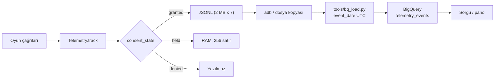

# 09 — Analitik ve deneyler

> **Karar:** Ölçüm sözleşmesi `docs/analytics/EVENTS.md`'dir; tek gerçek kaynak cihazdaki JSONL dosyalarıdır.
> Bugün hiçbir veri sunucuya gitmediği için D1/D7, huni ve reklam geliri ancak operatör dışa aktarımı ve
> BigQuery yüklemesinden sonra hesaplanabilir. Deneyler remote config olmadığından sürüm kohortlarıyla
> yürütülür; sonuçlar nedensel değil, karşılaştırmalı okunur.

Etiketler: **Mevcut**, **Planlanan**, **Açık**. Olay adları ve parametreleri için
[../analytics/EVENTS.md](../analytics/EVENTS.md); yükleme ve sorgular için
[../analytics/BIGQUERY.md](../analytics/BIGQUERY.md).

## 1. Ölçüm hattı

**Mevcut:** Olaylar cihazda; yükleme yok (`Telemetry.upload_url=""`). **Planlanan:** yönetilen bir sink ve
zamanlanmış yükleme. **Açık:** EEA/UK/CH için oyun içi analitik rıza kartı yok; bu bölgede satırlar bellekte
tutulup çıkışta kaybolur.

## 2. Soru → olay eşlemesi

| Ürün sorusu | Birincil olaylar | Not |
|---|---|---|
| Kaç kişi ilk bölümü bitiriyor? | `first_open` → `level_start` → `level_complete` | `level_start.source` campaign/daily/next/retry ayrımı |
| Nerede bırakıyor? | `level_abandon`, `level_fail`, `screen_checkpoint` | `level_fail` yalnızca can bitince |
| İpucu ne kadar kullanılıyor? | `booster_used` (`booster=hint`), `level_complete.hints_left` | `hint_type` dağılımı üretim kalitesini gösterir |
| Zorluk nerede kırılıyor? | `level_fail`, `level_complete.seconds/mistakes/stars` | Bölüm `size` ve `tier` ile kesilir |
| Reklam gösterimi gerçek mi? | `ad_offered`, `ad_shown.simulated`, `ad_closed` | Simüle ve gerçek ayrı filtrelenir |
| Reklam geliri? | `ad_impression` (`value`, `currency`, `precision`) | ILARE açık değilse `value=0` |
| Reklam yükü sorun mu? | `ad_load_failed`, `banner_failed` | Mükerrer kayıt 60 sn soğuma ile sınırlı |
| Oturum uzunluğu / performans | `session_start/end`, `performance_sample` | 60 sn'de bir FPS/bellek örneği |
| Dil değişimi | `language_changed`, `setting_changed` | `from`/`to` çifti |

## 3. Metrik tanımları

| Metrik | Tanım | Formül | Durum / sınır |
|---|---|---|---|
| D1 | Kurulumdan sonraki gün dönen kurulumlar | `first_open` günü `d`, `d+1`'de `session_start` olan `user_pseudo_id` / `first_open` sayısı | **Mevcut veri**, **Planlanan pano**; rıza vermeyenler paydada yok |
| D7 | 7. gün dönüş | Aynı yöntem, `d+7` | D1 ile aynı sınır |
| Bölüm 1 tamamlama | İlk bölümü bitirenler | `level_complete.level=1` / `first_open` | Yeniden oynama ayrı sayılır |
| Bölüm hunisi | Bölüm N'e ulaşma | `level_start.level=N` benzersiz kullanıcı / `first_open` | `source` filtresi şart |
| Bırakma oranı | Başlanıp bitirilmeyen | `level_abandon` + `level_fail` / `level_start` | Aynı oturumda yeniden başlatma çift sayılabilir |
| İpucu kullanımı | Bölüm başına ipucu | `booster_used(booster=hint)` / `level_start` | Ücretsiz reklam ödülleri ayrı sayılmaz |
| Ortalama yıldız | Tamamlanan bölüm yıldızı | `avg(level_complete.stars)` | 1–3 |
| Reklam doldurma | İstenen reklamın gösterilme oranı | `ad_shown(simulated=0)` / `ad_offered` | Simüle modal paydaya girmez |
| eCPM | 1000 gösterim geliri | `sum(ad_impression.value) / count(ad_impression) * 1000` | Para birimi bazında; yalnız gerçek reklam |
| Oturum süresi | Aktif oturum | `session_end.seconds` ortalaması | Zorla kapanışta olay yok |

**Kural:** Gelir ve doldurma metriklerinde `simulated=1` satırları her zaman dışlanır. `ad_impression`
yalnızca gerçek SDK reklamında ve analitik rızası `granted` iken yazılır; bu yüzden AdMob raporuyla birebir
eşleşmez, mutabakat AdMob tarafında yapılır.

## 4. Huni tanımı

1. `first_open` — kurulumun ilk oturumu (`session_number == 1`).
2. `level_start` (`source=campaign`) — ilk bölüme giriş.
3. `level_complete` — aynı bölümün çözülmesi.
4. `level_start` (`source=next`) — sonraki bölüme geçiş.
5. `level_complete.level >= 10` — ilk on bölümü aşan kohort.

Huni SQL'i `event_name` + `level` + `source` üzerinden yazılır; hazır sorgu kalıpları
[../analytics/BIGQUERY.md](../analytics/BIGQUERY.md) içindedir. Oturum sınırı için `session_id`, kullanıcı
sınırı için `user_pseudo_id` kullanılır; ikisi de rastgele ve hesaba bağlı değildir.

## 5. Deney altyapısı

| Yetenek | Durum | Sonuç |
|---|---|---|
| Remote config / feature flag | Yok | Deney aynı sürüm içinde açılıp kapatılamaz |
| Sunucu taraflı A/B | Yok | Randomizasyon yok |
| Play aşamalı yayın | Var (mağaza aracı) | Kullanıcı bazlı maruz kalma için kullanılabilir |
| Sürüm kohortu | Var | Mevsimsellik ve sürüm karışması riski |
| Olay şeması sürümü | `SCHEMA_VERSION=1` | Yeni alanlar geriye dönük eklenmeli |

**Karar:** Remote config gelene kadar her deney tek bir davranış değişikliği içerir, en az bir tam hafta ve
tam sürüm kohortlarıyla okunur; aynı anda ikinci bir değişiklik yayınlanmaz. Örneklem büyüklüğü ve minimum
tespit edilebilir etki, deney açılmadan önce 09'daki metrik tanımları üzerinden hesaplanır; bu belge sayısal
hedef uydurmaz.

## 6. Deney adayları

| ID | Hipotez | Değişiklik | Birincil metrik | Koruma metriği | Durum |
|---|---|---|---|---|---|
| E-01 | Daha seyrek interstitial D1'i artırır | Kolay aralığı 5 → 6 | D1 | `level_complete`, eCPM | **Planlanan** |
| E-02 | Cömert başlangıç ipucu ilk bölüm tamamlamayı artırır | Başlangıç 5 → 7 ipucu | Bölüm 1–3 tamamlama | İpucu reklam izleme | **Planlanan** |
| E-03 | Yıldız eşiği gevşetilirse tekrar oynama artar | 90/180 sn → 120/240 sn | Tekrar `level_start` | Ortalama yıldız | **Planlanan** |
| E-04 | Ücretsiz ödül miktarı reklam izlemeyi artırır | +2 → +1 ipucu/havuç | `ad_closed` (rewarded) | Ekonomi dengesi | **Planlanan** |
| E-05 | Günlük butonu ana eylem satırında daha çok tıklanır | Buton sırası değişimi | `ui_tap(daily)` | Bölüm başlangıcı | **Planlanan** |
| E-06 | İlk dokunuş "önce tavşan" modu hatayı azaltır | `bunny_first_tap_mode` varsayılanı | `mistake` / bölüm | Bölüm süresi, yıldız | **Planlanan** |

**Açık:** E-01 ve E-04 gelir etkisini ölçmek için gerçek reklam kimlikleri ve ILARE gerektirir; test
kimlikleriyle yalnız davranış ölçülebilir, gelir ölçülemez.

## 7. Veri kalitesi kontrolleri

| Kontrol | Beklenti | İhlal işareti |
|---|---|---|
| Olay adı biçimi | `[a-z0-9_]{1,40}` | Boş veya kırpılmış ad |
| Parametre sayısı | ≤ 25 | Sessizce düşen alan |
| Oturum kimliği | Her satırda dolu | Eksik `session_id` |
| `level` bağlamı | Oyun içinde 1 tabanlı | Oyun dışında 0 |
| Reklam ayrımı | `simulated` alanı okunur | Gelire simüle satır karışması |
| `event_date` | UTC ve `event_ts_us` ile tutarlı | Yerel saat kayması |
| Tekrar `ui_tap` | 300 ms içinde tek kayıt | Çift sayım |

## 8. Yeni olay kabul süreci

1. Soru ve karar sahibi yazılır; olay mevcut bir soruyu yanıtlamıyorsa eklenmez.
2. `EVENTS.md` sözlüğüne ad, parametre, tip ve çağrı yeri eklenir.
3. `Telemetry.track` çağrısı `scripts/` içinde tek yerde yapılır; serbest metin gönderilmez.
4. BigQuery şeması (`assets/analytics/bigquery_schema.json`) yeni alan gerektiriyorsa güncellenir.
5. Rıza kapısı ve `held` davranışı test edilir; `denied` durumda satır yazılmadığı doğrulanır.

## 9. Açık işler

- **Açık:** EEA/UK/CH analitik rıza kartı ve `held` satırların akıbeti.
- **Açık:** Sunucu sink'i, zamanlanmış yükleme ve pano yok.
- **Açık:** Çökme/ANR raporlaması yok; `performance_sample` çökme yerine geçmez.
- **Açık:** Satın alma olayları yok (IAP de yok); ileride `iap_*` olayları tanımlanmalı.
- **Açık:** `project.godot` sürümü `1.0.0`, Android `1.0.4`; kohort kırılımı `app_version` ile yapılacağından
  sürüm tekilleştirilmelidir.
- **Planlanan:** Deney kataloğunun remote config ile çalıştırılması ve pano otomasyonu.

İlgili: [../analytics/PRIVACY_AND_CONSENT.md](../analytics/PRIVACY_AND_CONSENT.md),
[../release/SHIP_CHECKLIST.md](../release/SHIP_CHECKLIST.md).
